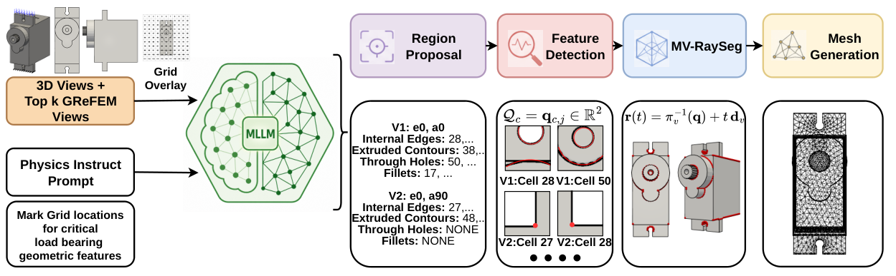
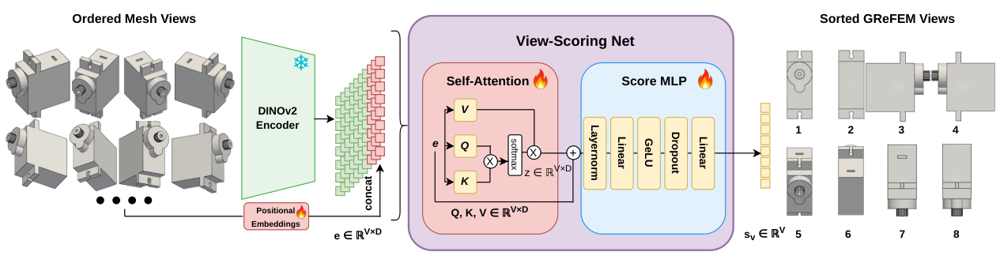

# GReFEM

**Multimodal LLMs as Zero-Shot Semantic Assistants for Physics-Guided 3D Mesh Refinement**

Kartik Bali, Mahish K. Guru, Christian J. Cyron, Roland Aydin

[](https://arxiv.org/abs/2607.08798)
[](http://creativecommons.org/licenses/by/4.0/)

---

## Overview

Adaptive volumetric finite-element meshing dictates the computational budget of
a CAE/FEM analysis. It traditionally requires either iterative PDE solvers in the
loop or heavily-supervised data-driven surrogates trained on large-scale
simulation data. **GReFEM** (*Geometric Reasoning Enhanced Multimodal LLMs for
Finite Element Meshing*) asks whether the high-level semantic understanding of
off-the-shelf Multimodal Large Language Models (MLLMs) can serve as a viable,
zero-shot geometric proxy for mesh refinement.

GReFEM uses an MLLM to visually localize stress-critical regions from
physics-guided textual prompts and rendered views of a CAD part, then converts
those 2D selections into a 3D volumetric sizing field. To bridge 2D MLLM
pre-training and 3D geometry, we introduce **orthoViews**, a supervised
view-selection module that maximizes the observability of key geometric features.



*The GReFEM pipeline: the top orthoViews-selected views are processed by the
Region Proposal and Feature Detection stages; the resulting 2D points are lifted
to 3D refinement anchors via MV-RaySeg, which drive a distance-based sizing field
for gmsh mesh generation and the downstream FEM solve (dolfinx).*

<details>
<summary><b>orthoViews view-selection module</b></summary>



*orthoViews performs self-attention across the V candidate views of each CAD
geometry, allowing each view embedding to aggregate information from all other
views before being scored by a per-view MLP.*

</details>

## Repository structure

### Core pipeline
| File | Role |
|------|------|
| `ortho_views.py` | orthoViews: view-candidate generation + geometric feature detection (FreeCAD) |
| `model.py` / `train.py` / `data.py` | orthoViews view-selector (DINOv2 backbone) training and dataset |
| `general_prompts.py` | Physics-guided prompt templates (Load-Only / Load+Features / Load+Features+Heuristics) |
| `infer.py` | orthoViews inference: rank candidate views and drop redundant ones |
| `infer_meshpoints.py` | One MLLM call over all selected views (grid-cell proposals), feature detection, and MV-RaySeg lifting to 3D anchors |
| `generate_renders.py` | Orthographic/perspective view rendering + load visualization |
| `generate_mesh_and_simulate.py` / `*_parallel.py` | Sizing field → gmsh mesh → FEM solve → QoI |
| `fem_fenics.py` | dolfinx linear-elasticity solver, ZZ error indicator, QoI extraction |
| `cad_utils.py`, `utils.py`, `cad_element_sizes.py` | CAD/mesh utilities |

### Baselines
| File | Policy |
|------|--------|
| `infer_baseline.py` | Blind geometric heuristic (concave sharp edges + smooth concave surfaces) |
| `infer_baseline_mech.py` | Load-informed heuristic (voxel cross-section properties + closed-form nominal stress) |
| `make_coarse_zz.py`, `compute_zz_pos.py` | ZZ-from-coarse-solve solver-informed policy |
| `solve_fine_reference.py`, `make_uniform_meshes.py` | Fine-reference solve (≈5·10⁶ elements) and ZZ-from-reference oracle |
| `build_amber_cache.py`, `make_amber_labels*.py`, `prepare_amber_data.py`, `infer_amber_grefem.py` | Retrained AMBER learned-AMR baseline |

### Aggregation, tables & figures (camera-ready)
| File | Output |
|------|--------|
| `compute_local_error_tables.py` | Per-case errors in Ω_crit from the solver shards |
| `table_combined_final.py` | `combined_final_table.csv` (156 parts × 5 loads, main policies) |
| `table_size_sensitivity.py` | `size_sensitivity_data.csv` (sizing sweep, per case) |
| `make_camera_ready_tables.py` | `camera_ready_units.csv` + [`camera_ready_tables.md`](camera_ready_tables.md) (all paper tables) |
| `loc_camera_ready.py` | `loc_camera_ready.csv` (anchor-level localization) |
| `make_cost_table.py` | Per-case cost table (mean cells, median max-displacement error and solve time) |
| `elem_prf1.py`, `hotspot_elemsize.py` | Element-level localization and element size at hotspots |
| `replot_f1_vs_views_19.py` | F1@r-vs-views figure (orthoViews and random views) |
| `make_applicability_table.py` | Related-work applicability table |

## Results

GReFEM is evaluated on **156 CAD parts** from the ABC and FreeCAD datasets,
disjoint from the orthoViews training and validation splits, each under
**5 loading cases** (compression, bending, torsion, bending+compression,
torsion+compression), giving **780 paired geometry–load cases**. Every case is
scored against an independent high-fidelity reference solve (uniform mesh of
≈5·10⁶ tetrahedra). Errors are relative to the reference quantity of interest
inside a fixed critical region Ω_crit, the neighbourhood (radius 4·h_min) of the
reference solution's top-0.1% Zienkiewicz–Zhu (ZZ) error points. All refined
policies are compared at a **matched element budget** (reduced to GReFEM's anchor
count, h_min calibrated to GReFEM's element count), so differences reflect
*where* elements are placed, not how many are spent. Cases are aggregated by the
5%-trimmed mean and the median. The four MLLMs (Gemini-3-flash, GPT-5.4-mini,
Claude-Haiku-4.5, Qwen3-VL-235B) receive the top five orthoViews views in a
single API call.

### Downstream FEM error at a matched budget

Relative error in peak von Mises stress (σ_vM^p99, the failure-relevant design
quantity) and strain energy in Ω_crit, lower is better (paper Table 1; "mean" is
the 5%-trimmed mean):

| method | information used | vm_p99 mean | vm_p99 med. | energy mean | energy med. | cells |
|-|-|-|-|-|-|-|
| Coarse (no refinement) | — | 0.739 | 0.786 | 0.944 | 0.967 | 24 660 |
| GReFEM (Gemini) | Load + Features + Heuristics | 0.626 | 0.649 | 0.879 | 0.919 | 95 052 |
| GReFEM (GPT-5.4-mini) | Load + Features + Heuristics | 0.630 | 0.651 | 0.873 | 0.915 | 96 481 |
| GReFEM (Claude-Haiku-4.5) | Load + Features + Heuristics | 0.643 | 0.652 | 0.880 | 0.925 | 87 216 |
| GReFEM (Qwen3-VL-235B) | Load + Features + Heuristics | 0.651 | 0.672 | 0.886 | 0.924 | 82 774 |
| GReFEM (Gemini) | Load + Features | 0.634 | 0.665 | 0.872 | 0.920 | 97 095 |
| GReFEM (GPT-5.4-mini) | Load + Features | 0.641 | 0.663 | 0.878 | 0.920 | 92 620 |
| GReFEM (Claude-Haiku-4.5) | Load + Features | 0.634 | 0.654 | 0.877 | 0.920 | 95 691 |
| GReFEM (Qwen3-VL-235B) | Load + Features | 0.646 | 0.675 | 0.889 | 0.930 | 84 970 |
| GReFEM (Gemini)† | Load-Only | 0.649 | 0.675 | 0.881 | 0.923 | 93 715 |
| GReFEM (GPT-5.4-mini)† | Load-Only | 0.666 | 0.693 | 0.890 | 0.925 | 93 226 |
| GReFEM (Claude-Haiku-4.5)‡ | Load-Only | 0.637 | 0.660 | 0.871 | 0.914 | 112 773 |
| GReFEM (Qwen3-VL-235B)‡ | Load-Only | 0.639 | 0.656 | 0.878 | 0.915 | 91 521 |
| Geometric heuristic (blind) | geometry only | 0.672 | 0.696 | 0.892 | 0.928 | 93 683 |
| Load-informed heuristic | geometry + hand-derived closed-form stress | 0.567 | 0.591 | 0.869 | 0.914 | 87 746 |
| ZZ from coarse solve | 1 FEM coarse solve + ZZ estimator | 0.672 | 0.700 | 0.887 | 0.925 | 92 249 |
| AMBER (learned AMR) | supervised expert meshes + load | 0.625 | 0.660 | 0.869 | 0.915 | 84 856 |
| *ZZ from fine reference solve* | *1 FEM reference solve + ZZ estimator* | *0.549* | *0.578* | *0.850* | *0.908* | *81 929* |

† Budget-matched to GReFEM (the native *Load-Only* runs of Gemini and GPT place
more anchors). ‡ Not budget-matched (native element count). The fine-reference
ZZ policy is an oracle reference. AMBER fails to mesh ≈6% of cases (735 cases
evaluated).

- With no FEM solve, no simulation training data and no hand-derived mechanics,
  GReFEM (Gemini) has lower peak-stress error than the blind geometric heuristic
  (0.626 vs. 0.672) and than ZZ refinement from a coarse FEM solve (0.672), and
  closes **60%** of the gap between the coarse mesh and the reference-solve
  oracle. Its forward cost is view rendering plus one MLLM call (median ≈7 s).
- GReFEM and the retrained AMBER baseline are statistically indistinguishable in
  peak-stress error (0.626 vs. 0.625; paired Wilcoxon p = 0.72 on the 735 cases
  both mesh); AMBER has a slightly lower strain-energy error (0.869 vs. 0.879).
  GReFEM needs no expert meshes or reference solves and has no meshing failures.
- The load-informed heuristic is stronger (0.567, closing 91% of the gap), but
  requires hand-derived beam-theory stress formulas for each load family;
  GReFEM adapts to a new load family by editing the prompt.

### The feature list in the prompt matters more than the MLLM

With the feature-enumerating prompts all four MLLMs lie within 0.025 in peak-stress
error. Removing the feature list (*Load-Only*) makes the models propose more
anchors with lower precision and, at a matched budget, raises peak-stress error;
adding load-specific heuristic hints has no consistent effect.

| prompt | Gemini vm_p99 | GPT-5.4-mini vm_p99 |
|-|-|-|
| Load + Features + Heuristics | 0.626 | 0.630 |
| Load + Features | 0.634 | 0.641 |
| Load-Only (budget-matched) | 0.649 | 0.666 |

### Sizing sweep

Relative σ_vM^p99 / strain-energy error in Ω_crit as a common scale factor is
applied to h_min and h_max; every baseline is re-matched to GReFEM's element
budget at each level (773–780 cases per level; GReFEM pools all four MLLMs):

| sizing | mean cells | GReFEM | Geom. heur. | Load-inf. | ZZ coarse | AMBER | *ZZ fine ref.* |
|-|-|-|-|-|-|-|-|
| h × 1.0 | 90k | 0.637/0.879 | 0.672/0.892 | 0.567/0.869 | 0.672/0.887 | 0.625/0.869 | *0.549/0.850* |
| h × 1.25 | 54k | 0.689/0.903 | 0.687/0.895 | 0.627/0.890 | 0.717/0.905 | 0.657/0.891 | *0.608/0.869* |
| h × 1.6 | 32k | 0.728/0.928 | 0.745/0.934 | 0.686/0.915 | 0.728/0.926 | 0.716/0.927 | *0.700/0.915* |
| h × 2.0 | 20k | 0.749/0.938 | 0.766/0.943 | 0.734/0.928 | 0.760/0.944 | 0.736/0.931 | *0.728/0.931* |

GReFEM's advantage over the blind heuristic and coarse-solve ZZ is largest at the
full budget and decays toward parity as elements become scarce; the load-informed
heuristic stays ahead at every level, and GReFEM and AMBER differ by at most 0.032.

### Per-case cost

Pooled over all 780 cases; the GReFEM row averages all four MLLMs:

| method | mean cells | max-disp. err (med.) | solve time (med.) | anchor-placement cost (med.) |
|-|-|-|-|-|
| Coarse | 24 660 | 0.025 | 0.2 s | — |
| GReFEM | 90 379 | 0.023 | 0.8 s | ≈7 s: render + 1 MLLM call; **no solve** |
| Geometric heuristic | 93 683 | 0.022 | 0.8 s | <1 s; no solve |
| Load-informed heuristic | 87 746 | 0.022 | 1.0 s | <1 s; no solve |
| ZZ from coarse solve | 92 249 | 0.021 | 2.5 s | 1 coarse solve + ZZ |
| ZZ from fine reference solve | 81 929 | 0.021 | 0.6 s | reference solve (≈35–60 min) |

### View selection (orthoViews)

On the 19 benchmark parts of the original submission set (inference at 1–10
views), Gemini's anchor-level F1@r with orthoViews is higher than with randomly
selected views at every view count, by 0.024–0.123 (0.075–0.082 at five views);
F1 plateaus after 4–5 views.

### Localization overlap vs. downstream error

Anchor-level overlap with the reference ZZ field does not reproduce the
downstream ranking: reduced to GReFEM's anchor count, the blind heuristic has
higher recall and F1 than every MLLM variant, yet higher peak-stress error. The
element size the final mesh places at the reference hotspots does follow the
ranking (median 0.42 load-informed, 0.45 GReFEM, 0.49 blind heuristic).

<details>
<summary><b>Appendix tables</b> (anchor-level localization, per load case, sensitivity, element-level localization)</summary>

#### Anchor-level localization

Precision@r, Recall@r and F1@r against the top-1% reference ZZ points
(r = 4·h_min, top five orthoViews views), averaged over cases; *n* is the number
of cases in which the variant returned anchors.

| model / baseline | prompt | P@r | R@r | F1@r | avg pts (k) | cell mentions/view | n |
|-|-|-|-|-|-|-|-|
| Gemini-3-flash-preview | Load+Features+Heuristics | 0.553 | 0.619 | 0.523 | 4.7 | 18.6 | 756 |
| | Load+Features | 0.552 | 0.651 | 0.540 | 4.9 | 22.1 | 758 |
| | Load-Only | 0.539 | 0.692 | 0.547 | 5.4 | 9.6 | 764 |
| Claude-Haiku-4.5 | Load+Features+Heuristics | 0.545 | 0.561 | 0.485 | 4.2 | 15.3 | 748 |
| | Load+Features | 0.537 | 0.622 | 0.517 | 4.8 | 19.9 | 767 |
| | Load-Only | 0.525 | 0.721 | 0.551 | 5.9 | 15.2 | 774 |
| GPT-5.4-mini | Load+Features+Heuristics | 0.549 | 0.644 | 0.526 | 4.4 | 38.6 | 769 |
| | Load+Features | 0.547 | 0.643 | 0.526 | 4.3 | 36.6 | 757 |
| | Load-Only | 0.520 | 0.778 | 0.579 | 6.5 | 25.5 | 771 |
| Qwen3-VL-235B | Load+Features+Heuristics | 0.572 | 0.577 | 0.504 | 3.4 | 62.9 | 735 |
| | Load+Features | 0.565 | 0.585 | 0.505 | 3.8 | 50.3 | 717 |
| | Load-Only | 0.534 | 0.648 | 0.522 | 4.5 | 18.2 | 735 |
| Geometric heuristic (blind) | native count | 0.567 | 0.822 | 0.609 | 6.0 | — | 780 |
| | GReFEM-Gemini count | 0.571 | 0.770 | 0.596 | 3.7 | — | 756 |
| Load-informed heuristic | native count | 0.601 | 0.488 | 0.469 | 1.9 | — | 780 |

#### Downstream error per load case

σ_vM^p99 / strain-energy error (trimmed mean); GReFEM rows use the
*Load+Features+Heuristics* prompt.

| policy | Compression | Bending | Torsion | Bending + Comp. | Torsion + Comp. |
|-|-|-|-|-|-|
| Coarse (no refinement) | 0.739/0.948 | 0.733/0.940 | 0.730/0.943 | 0.742/0.941 | 0.744/0.943 |
| GReFEM (Gemini) | 0.659/0.899 | 0.623/0.869 | 0.622/0.868 | 0.600/0.850 | 0.617/0.896 |
| GReFEM (GPT-5.4-mini) | 0.655/0.889 | 0.637/0.880 | 0.623/0.871 | 0.607/0.851 | 0.624/0.863 |
| GReFEM (Claude-Haiku-4.5) | 0.671/0.897 | 0.654/0.889 | 0.639/0.862 | 0.608/0.858 | 0.637/0.879 |
| GReFEM (Qwen3-VL-235B) | 0.673/0.901 | 0.660/0.885 | 0.643/0.878 | 0.626/0.859 | 0.642/0.894 |
| Geometric heuristic (blind) | 0.698/0.911 | 0.697/0.905 | 0.658/0.877 | 0.645/0.860 | 0.656/0.892 |
| Load-informed heuristic | 0.633/0.888 | 0.574/0.872 | 0.514/0.851 | 0.550/0.831 | 0.562/0.888 |
| ZZ from coarse solve | 0.710/0.919 | 0.688/0.898 | 0.652/0.879 | 0.630/0.838 | 0.671/0.877 |
| AMBER (learned AMR) | 0.616/0.860 | 0.654/0.893 | 0.638/0.864 | 0.610/0.867 | 0.602/0.859 |
| *ZZ from fine reference solve* | *0.607/0.858* | *0.572/0.874* | *0.570/0.859* | *0.472/0.791* | *0.523/0.857* |

Paired median Δσ_vM^p99, GReFEM (Gemini) − baseline (negative favours GReFEM),
with two-sided Wilcoxon *p*:

| vs. | Compression | Bending | Torsion | Bending + Comp. | Torsion + Comp. |
|-|-|-|-|-|-|
| geometric heuristic | −0.021 (0.013) | −0.064 (5·10⁻⁷) | −0.027 (0.020) | −0.030 (0.007) | −0.005 (0.038) |
| load-informed heuristic | +0.032 (0.034) | +0.013 (0.042) | +0.065 (8·10⁻⁶) | +0.027 (0.049) | +0.042 (0.004) |
| ZZ from coarse solve | −0.040 (0.001) | −0.040 (5·10⁻⁵) | −0.039 (0.005) | −0.030 (0.082) | −0.047 (0.001) |
| AMBER | +0.053 (0.035) | −0.017 (0.15) | −0.022 (0.50) | −0.031 (0.53) | +0.029 (0.15) |

#### Sensitivity of GReFEM's error across experimental dimensions

| dimension | types | vm_p99 std | vm_p99 range | energy std | energy range |
|-|-|-|-|-|-|
| MLLM | 4 | 0.006 | 0.018 | 0.005 | 0.014 |
| Prompt | 3 | 0.002 | 0.005 | 0.005 | 0.011 |
| Load case | 5 | 0.021 | 0.063 | 0.014 | 0.041 |
| Sizing level | 4 | 0.044 | 0.116 | 0.024 | 0.064 |
| *Refinement policy (reference)* | 5 | 0.039 | 0.105 | 0.009 | 0.023 |

#### Element-level localization

Predictions are deeply refined elements (size ≤ 1.25·h_min) against the top-0.1%
reference ZZ hotspots; element size at hotspots is the median cube root of
tetrahedron volume within r of a hotspot.

| method | P | R | F1 | elem. size at hotspots (med.) | vm_p99 mean |
|-|-|-|-|-|-|
| GReFEM | 0.318 | 0.903 | 0.432 | 0.45 | 0.626 |
| Geometric heuristic (blind) | 0.313 | 0.922 | 0.427 | 0.49 | 0.672 |
| Load-informed heuristic | 0.350 | 0.829 | 0.432 | 0.42 | 0.567 |

</details>

All paper tables (incl. per-load-case, sensitivity, cost and localization) are
regenerated by `make_camera_ready_tables.py` into
[camera_ready_tables.md](camera_ready_tables.md); definitions are in the paper.

## Data (HuggingFace)

The case-level result tables backing the paper's tables and figures are
consolidated under [`hf_dataset/`](hf_dataset/) with a full manifest and column
reference in [`hf_dataset/README.md`](hf_dataset/README.md), ready to upload to
HuggingFace.

## Environment

```bash
conda env create -f environment.yml
```

Core dependencies: `dolfinx`/FEniCSx, `gmsh`, `FreeCAD`, `trimesh`, `pyvista`,
`torch` + `torchvision` (DINOv2), and an OpenRouter API key for the MLLMs
(Gemini-3-flash, GPT-5.4-mini, Claude-Haiku-4.5, Qwen3-VL-235B).
The AMBER baseline uses the code under `baselines/AMBER/` (not vendored here).

## Citation

```bibtex
@article{bali2026grefem,
  title   = {GReFEM: Multimodal LLMs as Zero-Shot Semantic Assistants for Physics-Guided 3D Mesh Refinement},
  author  = {Bali, Kartik and Guru, Mahish K. and Cyron, Christian J. and Aydin, Roland},
  journal = {arXiv preprint arXiv:2607.08798},
  year    = {2026}
}
```

## License

Released under [CC BY 4.0](http://creativecommons.org/licenses/by/4.0/), matching
the paper.
